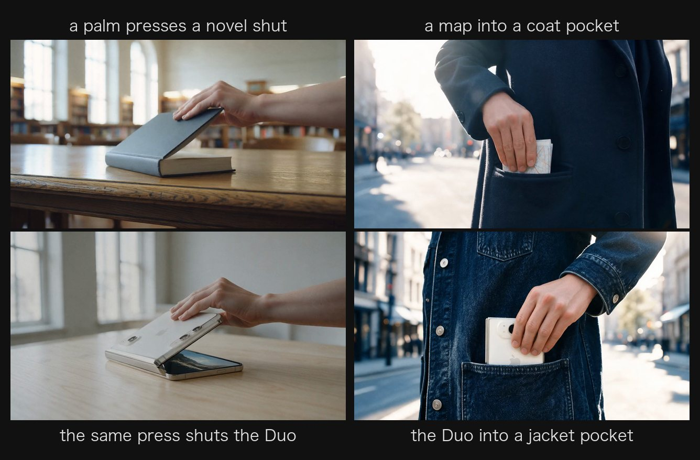
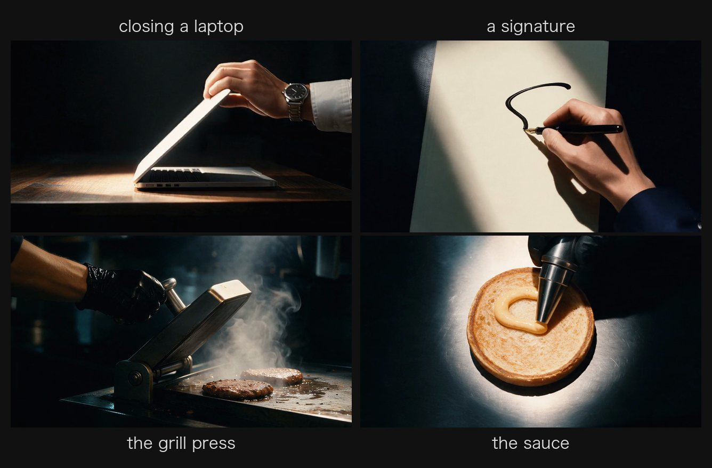

<div align="center">

# match-cut

[简体中文](README.md) | **English**

An agent skill for making product films (20 s by default; any length works).<br>
One shape or gesture keeps moving while the world changes at every cut, on a strict beat grid, ending on a hero
shot and an end card.


```sh
npx skills add Sac-Y/match-cut
```

[Examples](#examples) · [Install](#install) · [Use](#use)

</div>

## Examples

### iPhone Duo · Open Up (20 s)

A book-style foldable phone, on one idea: "folds small, opens big". Things that fold and open in many worlds hand
their motion on to the Duo.




Full film: [preview.mp4](examples/iphone-duo/preview.mp4) · How it was made: [README](examples/iphone-duo/README.md)

### Big Mac · Noon Relay (22 s)

At noon, everyday objects across a city hand their shape or motion to the Big Mac being built in a kitchen; the
voice-over reads the ingredients, one word per shot.




Full film: [preview.mp4](examples/big-mac/preview.mp4) · How it was made: [README](examples/big-mac/README.md)

<sub>Both are unofficial spec films made to test the skill; not affiliated with Apple or McDonald's.</sub>

## Install

**1. Add the skill** (works for Claude Code and Codex; the installer detects them)

```sh
npx skills add Sac-Y/match-cut
```

It installs into the current project; add `-g` for all projects. Needs Node.js 22.20 or later.

**2. Connect Renoise** (video, music and foley go through it; skip if already connected)

Claude Code:

```sh
claude mcp add --transport http renoise https://renoise.ai/api/public/mcp
```

Restart Claude Code, run `/mcp`, choose `renoise` and sign in in the browser.

Codex:

```sh
codex mcp add renoise --url https://renoise.ai/api/public/mcp
codex mcp login renoise
```

You can also leave this step to the agent; you only sign in in the browser. Python and ffmpeg need no setup: the
agent prepares them on first use.

## Use

Ask in plain words, for example "make a 20-second match-cut promo for our new water bottle". The agent:

1. Checks that Renoise answers and tells you what each part bills: on Codex the stills come from the built-in image
   tool, billed to your ChatGPT plan; on Claude Code they come from Renoise, billed in Renoise credits.
2. Collects the product facts and official images, and proposes a base plan: angle, structure, worlds, copy,
   models, budget.
3. Asks how to run:
   - **Straight through**: you approve the plan and budget once and get the finished film.
   - **Checkpoint by checkpoint**: you approve the plan, then the animatic and video quote, then the film.
4. Delivers a 1080p mp4, a ProRes master and stems, with a README per version.

## License

[MIT](LICENSE)
