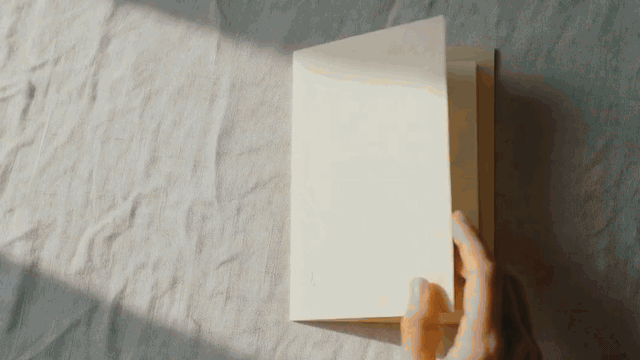
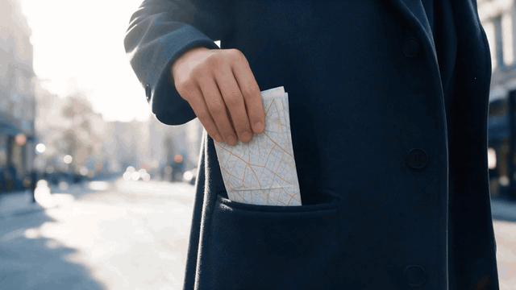
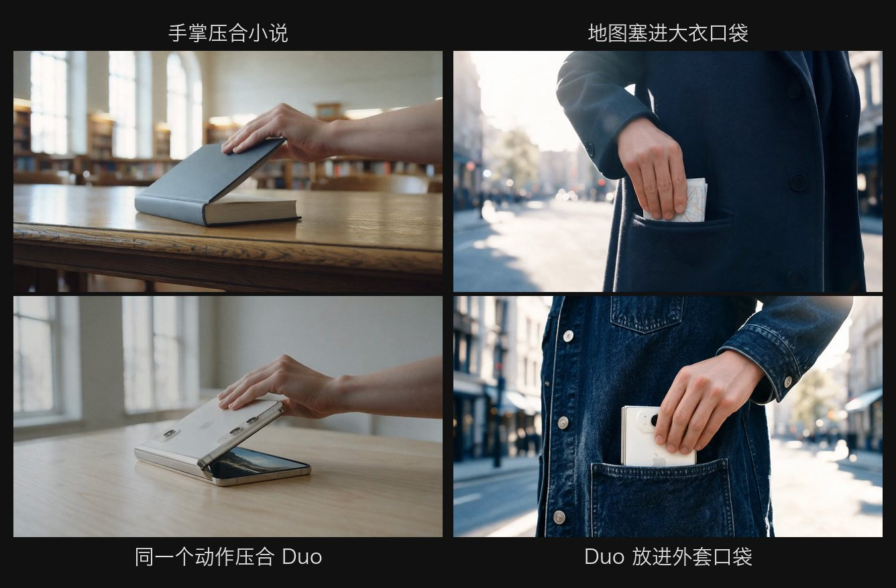
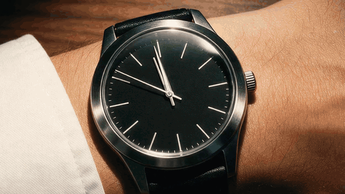
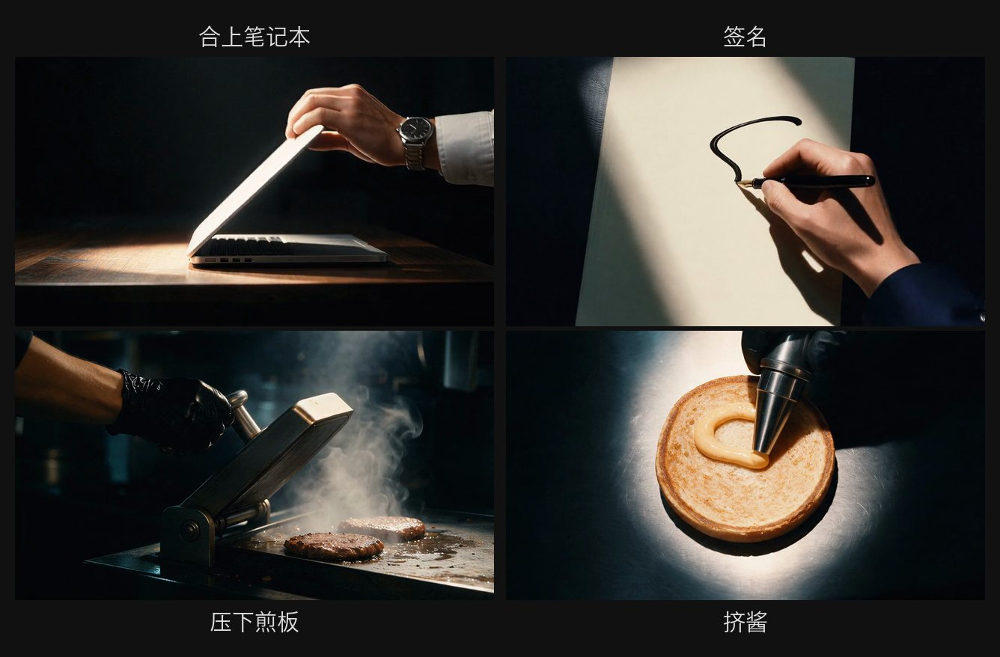

<div align="center">

# match-cut

**简体中文** | [English](README.en.md)

一个用来制作产品宣传片的 Agent Skill（默认 20 秒，时长可以按需要定）。<br>
同一个形状或动作一直延续，每一刀切换一个世界，严格卡在节拍上，最后落到产品主镜头和片尾 Logo。



```sh
npx skills add Sac-Y/match-cut
```

[看案例](#案例) · [安装](#安装) · [怎么用](#怎么用)

</div>

## 案例

### iPhone Duo · Open Up（20 秒）

一支书本式折叠屏手机的片子，主题是"折起来很小，打开很大"：不同世界里被折起、打开的东西，把动作一路交给 Duo。





完整成片：[preview.mp4](examples/iphone-duo/preview.mp4) · 制作记录：[README](examples/iphone-duo/README.md)

### Big Mac · Noon Relay（22 秒）

正午的城市里，日常物件把形状和动作交给厨房里正在组装的巨无霸，旁白念配料，每个词落在一个镜头上。





完整成片：[preview.mp4](examples/big-mac/preview.mp4) · 制作记录：[README](examples/big-mac/README.md)

<sub>两支都是测试 skill 用的非官方试作，与 Apple、麦当劳无关。</sub>

## 安装

**1. 装 skill**（Claude Code 和 Codex 通用，会自动识别）

```sh
npx skills add Sac-Y/match-cut
```

默认装到当前项目，加 `-g` 装到全局。需要 Node.js 22.20 以上。

**2. 连接 Renoise**（视频、音乐、音效都走它；已经连过就跳过）

Claude Code：

```sh
claude mcp add --transport http renoise https://renoise.ai/api/public/mcp
```

重启 Claude Code，输入 `/mcp`，选 `renoise`，在浏览器里登录。

Codex：

```sh
codex mcp add renoise --url https://renoise.ai/api/public/mcp
codex mcp login renoise
```

这一步也可以直接交给 Agent 去做，你只需要在浏览器里登录。Python 和 ffmpeg 不用自己装，第一次用时 Agent 会准备好。

## 怎么用

直接用自然语言提需求就行，比如"给我们的新款水杯做一支 20 秒的匹配剪辑宣传片"。Agent 会：

1. 确认 Renoise 能连上，告诉你各部分怎么计费：定帧在 Codex 里用自带的生图工具，扣 ChatGPT 订阅额度；在 Claude Code 里用 Renoise，扣 Renoise 积分。
2. 收集产品信息和官方图片，给出基础方案：切入角度、结构、每个世界的场景、文案、模型和预算。
3. 问你想怎么推进：
   - **一口气做完**：方案和预算确认一次，之后不再打扰，直接交付成片。
   - **逐个节点确认**：方案、粗剪和视频报价、成片，三处各确认一次。
4. 交付 1080p mp4、ProRes 母版和分轨，每个版本附一份说明。

## 许可

[MIT](LICENSE)
